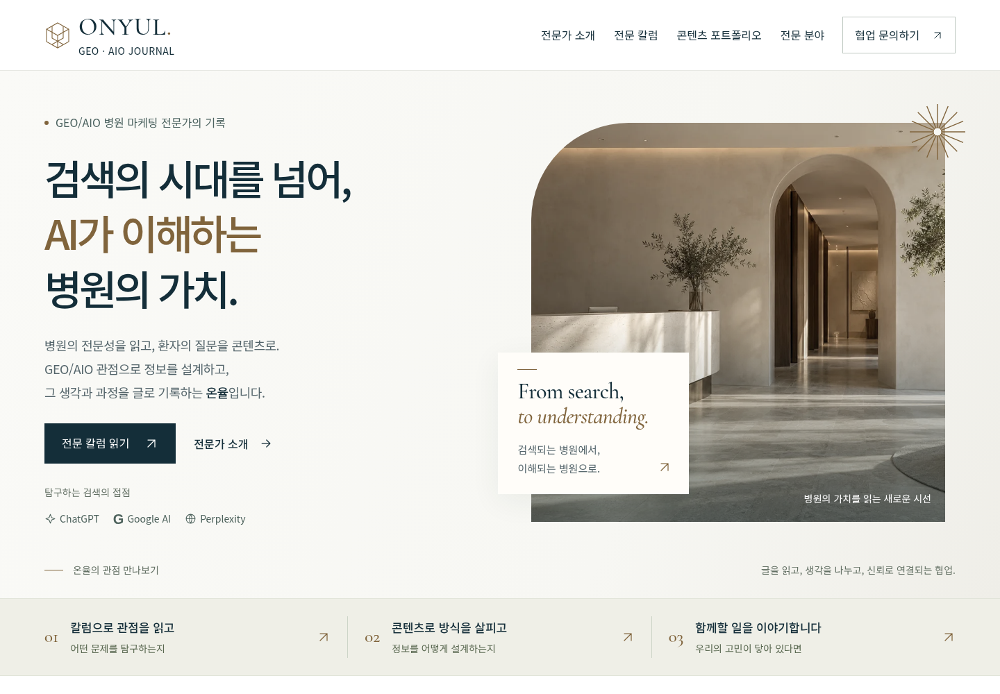
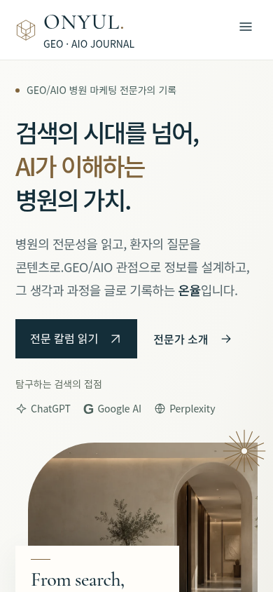

# 온율 개인 전문가 홈페이지 미리보기

개인 프로필과 전문 칼럼 중심으로 개선한 최신 미리보기입니다. 본문 18px, 설명 14~17px, 메뉴·버튼 16px 이상을 기준으로 PC와 모바일 가독성을 개선했습니다. 홈페이지를 인터넷에 배포한 것이 아닙니다.

## 브라우저에서 확인하기

1. [onyul-preview.html](onyul-preview.html)을 엽니다.
2. GitHub 파일 화면의 **Download raw file** 버튼으로 컴퓨터에 저장합니다. 저장할 때 파일 확장자 `.html`을 유지하세요.
3. 저장한 파일을 Chrome 또는 Edge에서 엽니다. 창 너비를 줄이면 모바일 레이아웃으로 바뀝니다.

이름·사진을 넣을 수 있는 개인 소개, 콘텐츠 포트폴리오, 칼럼 목록·필터·본문, 관련 전문 분야와 문의 연결, 다음 글, 문의 내용 정리·파일 저장, 모바일 메뉴를 포함합니다. 글꼴과 이미지는 파일 안에 포함되어 있습니다. 문의가 외부로 자동 전송되지는 않습니다. 일부 브라우저에서는 로컬 파일의 클립보드 복사가 제한될 수 있으므로 문의 내용은 파일 저장으로 확인할 수 있습니다.

이 HTML은 독립형 스냅샷이며 소스를 수정해도 자동으로 갱신되지 않습니다. 최신 사이트는 저장소 루트의 README에 따라 실행하세요. 원격 개발 브라우저의 보안 정책으로 `file://` 접근이 제한되어, 동일한 HTML을 로컬 HTTP 서버로 제공해 탐색·칼럼 필터·문의 다운로드·모바일 메뉴를 검증했습니다.

소스와 미리보기 파일을 한 번에 받으려면 저장소의 **Code → Download ZIP**을 사용하세요.

## PC 화면

[PC 전체 페이지 캡처 열기](onyul-pc-full.png)

## 모바일 화면

[모바일 전체 페이지 캡처 열기](onyul-mobile-full.png)

## 미리보기 갱신

저장소 루트에서 `npm run preview:refresh`를 실행하면 최신 소스로 HTML과 캡처를 함께 갱신합니다. 정식 배포를 수행하는 명령이 아닙니다.
